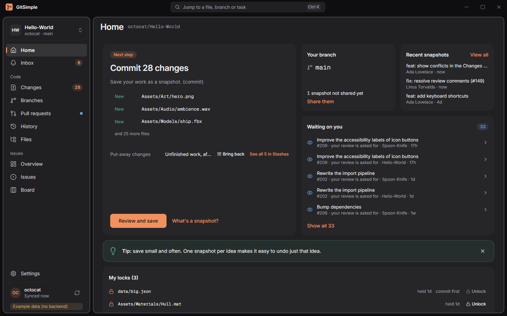
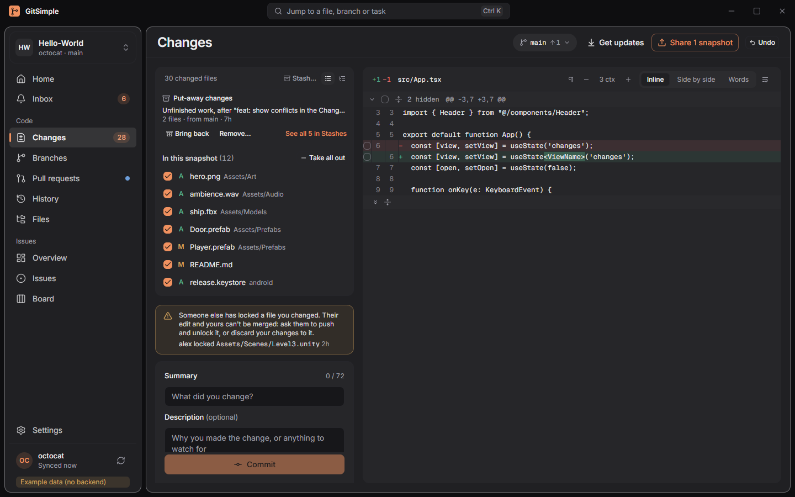
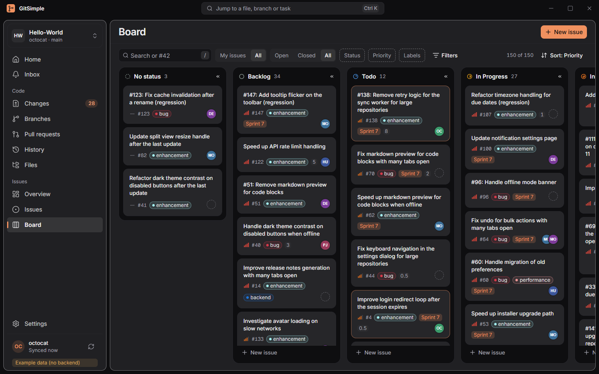
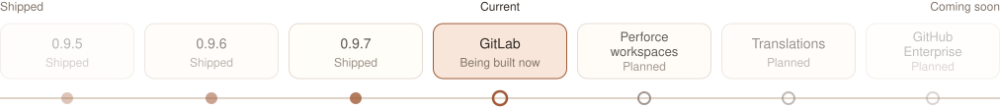

# GitSimple

**Your code and your GitHub issues, side by side, in one simple Windows app.**

Pick a repository, see what to do next, and do it: commit, push, open a pull request, move an issue across the board. No terminal needed.

This repository only holds GitSimple's installers, updates and user guide. The source code is private.

## GitSimple is invite-only

The app opens only for GitHub accounts on its invite list. If someone sent you this link, they have probably added you already. If the app says **"GitSimple is invite-only"** after you sign in, ask the person who invited you to check your GitHub username, then click **Check again**.

## Install

You need Windows 10 or 11 and [Git for Windows](https://git-scm.com/download/win). If Git is missing, the app tells you how to install it.

1. Open the [latest release](https://github.com/LandonThomp/GitSimple-releases/releases/latest) and download the file ending in **`_x64-setup.exe`** (under **Assets**).
2. Run it. It installs for your Windows user only, with no admin rights needed.
3. If Windows shows **"Windows protected your PC"**, click **More info**, then **Run anyway**. The installer isn't signed with a paid code-signing certificate, so Windows doesn't recognize it yet.

## First launch

1. Click **Sign in with GitHub**. Your browser opens GitHub, and the app shows a short code.
2. Enter the code on GitHub and approve. GitSimple asks for the `repo`, `read:org` and `project` scopes so it can work with your repositories, issues and Projects.
3. Add a repository: pick a folder that's already on your PC, or choose one of your GitHub repositories and clone it.

Your sign-in is stored in Windows Credential Manager, never in a file. You can sign out in **Settings, Account**.

## Updates

GitSimple checks for updates when it starts and every 6 hours, and shows a notification when a new version is out. Click **Update now**; the app restarts on the new version. Every update is checked against GitSimple's signing key before it installs.

To turn automatic checks off, go to **Settings, Updates**. You can still press **Check for updates** there at any time.

## How you use it

**Home** always shows one **Next step** button. Follow it and you go round the everyday loop:

<picture>
  <source media="(prefers-color-scheme: dark)" srcset="docs/images/workflow-dark.svg">
  
</picture>

**Commit your changes.** Tick what goes in, write a summary, commit.

**Plan on the board.** Drag an issue to change its status.

GitSimple starts in **Basic** mode: the everyday views, in plain words. Switch to **Advanced** in **Settings, Appearance, Interface** for stashes, tags, rebasing, the git console and more.

## User guide

One page per topic:

- **[Getting started](docs/guide/getting-started.md)**: sign in, add a repository, how Home picks the next step, Basic and Advanced mode
- **[Code](docs/guide/code.md)**: commit, pull and push, branches, history, pull requests, linking code to issues
- **[Advanced git](docs/guide/advanced-git.md)**: stashes, rewriting history, resolving conflicts, undo, tags, remotes, the console
- **[Issues](docs/guide/issues.md)**: list, board and sprints, the issue panel, GitHub Projects
- **[Settings](docs/guide/settings.md)**: every setting with its default, themes
- **[Keyboard shortcuts](docs/guide/shortcuts.md)**

<!-- roadmap:start: copied from docs/roadmap.md in the GitSimple source repo on each release. Edit it there; changes here are overwritten. -->
<picture>
  <source media="(prefers-color-scheme: dark)" srcset="docs/images/roadmap-dark.svg">
  
</picture>

## Current

- **Perforce workspaces**: a workspace whose code is on a Perforce server (issues stay on GitHub), plus the tracker features still missing (Severity, Component, Backlog)

## Coming soon

- **More GitLab**: GitLab To-Dos in the Inbox, reviews you finish before sending, tasks as sub-issues and a squash option
- **Translations**: the first languages. Everything the app shows can be translated now, including its error and preview messages; what's left is choosing languages and reviewers. Native dialogs, Windows notifications and the tray menu stay English until then
- **GitHub Enterprise**: notifications from an Enterprise Server in the Inbox, GitHub Projects mode and CI job logs on a server
- **More hosts**: Azure DevOps and Bitbucket

Plans can change, and nothing here has a date.
<!-- roadmap:end -->

## Please don't share the installer

Send people to whoever invited you instead. The installer won't open for anyone who isn't on the invite list.
