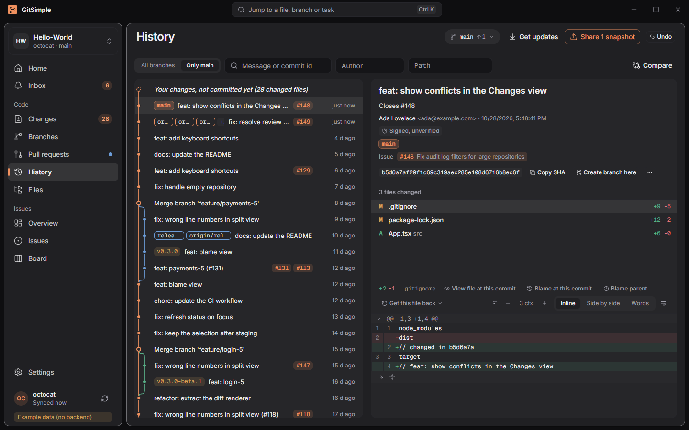

[User guide](README.md) › Code

# Code: changes, branches, history, pull requests

The everyday git work. The Code views need a local clone, except **Pull requests**.

## Changes

The file list is on the left, the commit box under it, and the diff of the selected file on the right. The list has up to four groups: **Conflicted**, **In this snapshot** (staged), **Not included** (changed, not staged) and **New files** (untracked). Each file has a checkbox: ticked files are in the next snapshot (commit). Tick or untick a box to add a file to the snapshot or take it out (stage / unstage); with a folder tree, a folder's box does the whole folder. **Add all** and **Take all out** at the top of a group do every file in it. **Discard all changes…** is in the group's **…** menu, apart from the other buttons, and shows a preview before anything is thrown away (Undo, `Ctrl+Z`, brings it back). With the keyboard, select files with the arrow keys (Shift for a range) and press Space to add or take them out.

Show the list flat or by folder; select several with Ctrl / Shift. Drag the border between the left column and the diff to make the file list wider or narrower (or focus it and use Left / Right); the width is remembered.

**Choose what goes in the commit:**

- a file, a selection, or everything;
- a single block of changes (a *hunk*), or **Discard this block**;
- single **lines**: tick the boxes in the diff gutter, Shift-click for a range.

**Write the commit:**

- a **Summary** (the counter beside it turns to a warning past 72 characters) and an optional **Description**;
- **For**: the issue the commit belongs to (taken from the branch name when it names one; pick another or remove it). The workspace's prefix, `#` or `GS-`, is added to the message;
- optional **co-authors**: pick people who worked on it with you from the recent authors of the repository and its GitHub users (their GitHub noreply address, so GitHub credits their account; for a repository on a GitHub Enterprise Server, only the recent authors for now, and the picker says so), or type `Name <email>` for anyone else. Each gets a `Co-authored-by:` line at the end of the message (no need to type those lines). You are never added as your own co-author, and the same person is added once;
- **Commit**. With nothing staged the button reads **Stage all and commit**.

**More options** (Advanced mode, beside **For**) opens the co-authors and **Add to last commit (amend)**. It stays open while you amend or have co-authors picked.

**Message helpers** (off until you turn them on for the repository in [Settings > Git > Advanced](settings.md#advanced), under **Commit message helpers**):

- **Conventional Commits:** a **Type** list, a **Scope** box and **Breaking change** above the summary write `feat(ui)!: ` in front of it. The summary stays the text you edit: typing the prefix yourself sets the controls too. Scopes from the settings are suggested; any other can be typed. A summary without one of the types gets a hint. With the issue reference style **Key in front**, the key goes after the type (`feat(ui): #42 add login`), so the message stays a Conventional Commit.
- **Check the message format:** hints under the description for a summary that ends with a period, a summary that doesn't read as a command ("Added ..." rather than "Add ..."), and description lines longer than the width you set (72 characters by default; long URLs and code are left alone). **Wrap lines** breaks the long lines at spaces. These are only hints: the commit is never blocked.
- **Recent summaries:** **Recent** lists the last summaries of the current branch (no merges or repeats) to reuse one (without an issue key in front, so it doesn't refer to the old issue). Picking one over a summary you typed can be undone from the message that appears.

The commit box always puts a blank line between the summary and the description, so there is nothing to check there.

**Add to last commit (amend)** shows what it replaces and warns when that commit is already pushed. While amending, the picker shows the last commit's co-authors (not the description), so you can add or remove them; they are written back once. Co-authors picked for your next commit come back when you turn amend off. Co-authors are read from the message's final block of `Key: value` lines only; a line mixed in with other text stays in the description.

**Who commits:** under the message the box shows the name and email git will use (hover to see which configuration each comes from: this repository, your global config, ...). When the repository has an identity chosen under **Settings > Workspaces > Commit as** and git would use another one, the box says so; **Apply…** shows the change to the repository's `.git/config` (old and new `user.name` / `user.email`) and writes it when you confirm. Nothing else in your git configuration is changed. See [Identities](settings.md#identities-collapsed-in-basic-mode-until-you-have-one).

When git has no name or email at all, the box says **Commits need your name and email**. With no saved identities, **Set name and email…** asks for them, saves them as an identity, chooses it for this repository and shows the usual preview of writing it into the repository's config; with saved identities, **Choose identity…** opens Settings > Workspaces.

On a small window the file list keeps at least about half of the column; the commit box and its warnings scroll, and the **Commit** button stays in view.

**Signed commits:** GitSimple follows your git configuration. With `commit.gpgsign` on, the box says **Commits will be signed (SSH)** (or GPG, X.509) and git signs as usual with `gpg.format`, `user.signingkey` and `gpg.program` / `gpg.ssh.program`. There is no switch in GitSimple. git runs without a console window, so a signer can't ask for a passphrase in a terminal:

- **SSH keys** need ssh-agent (Windows: start the "OpenSSH Authentication Agent" service, then `ssh-add` your key once), or a key without a passphrase;
- **GPG keys** need a graphical pinentry (Gpg4win's), or a key gpg-agent has already unlocked.

When signing fails the commit isn't made and the error says why, with these hints. A signer that hangs is stopped after the network time limit (Settings > Git > Advanced; it also applies to commands that may run hooks).

**Drafts:** an unfinished summary, description and the co-authors picked are kept per repository and branch, on this computer. They come back when you return to Changes, switch back to the branch or restart GitSimple, and after a commit that failed (a hook rejected it, say). A successful commit clears the draft. A message that looks like it holds a secret (a token, a password, a URL with a password in it; the same rule as the [console](advanced-git.md#the-git-console)'s history) is never saved. While amending, the text comes from the last commit and isn't saved as a draft.

**Locks:** with Git LFS installed, changed files show a padlock when they are locked, and a warning names whoever else locked a file you changed. See [Git LFS](advanced-git.md#locks).

### Safety net before a commit

Above the commit button, GitSimple checks what is staged and warns. It never blocks the commit, and nothing leaves your computer.

- **Big files:** a staged file over 100 MB (GitHub refuses the push) or over 50 MB. **Track \*.ext with LFS** stores it with Git LFS instead (see [Big files before a commit](advanced-git.md#big-files-before-a-commit)). Without Git LFS installed, the warning says how to install it.
- **Conflict markers:** a staged text file that still has `<<<<<<<`, `=======` or `>>>>>>>` lines from a merge. A file needs a `<<<<<<<` or `>>>>>>>` line to count, because a lone `=======` is also how Markdown underlines a heading. Unity can't load a scene, prefab or asset with markers in it.
- **Possible secrets:** private key blocks (`-----BEGIN ... PRIVATE KEY-----`), GitHub tokens (`ghp_`, `gho_`, `ghu_`, `ghs_`, `ghr_`, `github_pat_`), AWS access key IDs (`AKIA...`, `ASIA...`), Google API keys (`AIza...`), and keystore files (`.keystore`, `.jks`, `.p12`, `.pfx`). Only these well-known shapes are checked, so most findings are real. A finding shows the first 4 characters and `••••`, never the whole value.
- **Your own rules:** each repository can add its own checks in [Settings > Git > Advanced](settings.md#safety-net-rules): patterns for secrets (an internal token format, say), file patterns such as `*.env`, and a size from which files are flagged. A finding names the rule that found it; a short match shows fewer characters (a third of it), so it isn't shown whole.

Only the lines the commit adds are checked, so a secret that is already in the history isn't reported again (remove it from the history and revoke it separately). Very large staged changes are checked up to 16 MB.

**Not a secret** hides that value wherever it appears; **Don't check this file** stops checking that file for secrets (it doesn't add it to `.gitignore`; for that, see [Ignore](#ignore-a-file-or-stop-tracking-it)). Both also apply to the [safety net before a push](#safety-net-before-a-push), and the other way round. GitSimple remembers only a fingerprint of the value (it can't be turned back into the value) and the file's path, in this computer's app storage.

**Right-click a file or folder** (see [Open in your editor, Explorer or a terminal](#open-in-your-editor-explorer-or-a-terminal)) to open it in your editor, show it in Explorer or open a terminal there.

### Ignore a file, or stop tracking it

Right-click a file in **New files** and open **Ignore**:

- **Write the rule to** (choose first; the menu stays open): the repository's `.gitignore`, the `.gitignore` in the file's folder, or `.git/info/exclude`, which only this copy of the repository uses and is never committed (worktrees of the repository share it). In Basic mode only the two `.gitignore` files are offered: a rule there shows up in Changes and can be undone like any change, while nothing in GitSimple shows `.git/info/exclude`.
- Then pick what to ignore: **This file**, **All .ext files** (with this file's extension), or **This folder**. A folder's own `.gitignore` can't ignore that folder, so **This folder** goes to the root `.gitignore` or `.git/info/exclude`.

A preview shows the exact line, the file it is added to (created when missing) and the new files it hides. **Ignore** adds the line at the end of the file in the file's own line endings; nothing else in it changes. The files leave **New files** right away. Commit the `.gitignore` so the whole team ignores them. Special characters in names (`*`, `?`, `[`) are escaped, so the rule only matches that name.

Ignoring doesn't affect files git already tracks. For those, right-click the file in **Not included** or **In this snapshot** and choose **Stop tracking (keep on disk)**. A preview lists the files; confirming runs `git rm --cached`: the files stay in your folder and show as new files, and the removal is staged. When you commit it, the files are removed from the repository, and everyone who pulls that commit has them deleted from their folder, so ignore them as well.

## Sync: check, pull, push

These buttons are in the header of every Code view, with progress and **Stop**. Basic mode uses everyday words; the git term is in each button's tooltip.

| Basic | Advanced | What it does |
| --- | --- | --- |
| **Get updates** | **Check for new commits**, then **Pull** | Basic: one button that looks for new snapshots and opens the pull preview to bring them into your branch (`git fetch`, then `git pull`). On a branch with no remote copy it only looks (`git fetch`). Advanced: the two steps as separate buttons |
| **Share N snapshots** | **Push N** | Uploads your snapshots (commits). A branch with no remote copy shows **Publish branch** instead |
| | **Overwrite remote branch (force push)…** | Advanced mode, in the **…** menu next to Push. Uses a lease, previews the remote commits it would discard, never a plain force push |

Pull, push and anything that can lose work (discard, delete branch, merge, amend) first show a **preview** of exactly what will happen. A preview works once, and only if nothing changed since. A rejected push tells you to pull first.

### Safety net before a push

The push preview (and the force push preview, and the preview of [moving files into LFS in the whole branch](advanced-git.md#moving-committed-files-into-lfs), which force-pushes) runs the [commit safety net](#safety-net-before-a-commit) again, over the commits the push sends: the commits that are neither on your remote branch nor on any other remote branch. Commits you merged in from `origin/main`, say, are already on the server and aren't checked again. That catches what the commit check never saw: a commit made with `git commit` in a terminal or another tool, or a warning you dismissed and committed anyway.

- **Check before you push** lists the findings under the commit they came from (its short id and summary): conflict markers, possible secrets and keystore files, and files of 50 MB or more (red at 100 MB, where GitHub refuses the push).
- The rules are the same as at commit time, and only the lines each commit adds are checked, so something already on the remote isn't reported again. What the push sends is read up to 16 MB (the first 1000 commits); if there is more, the preview says part of it wasn't checked, and if the check fails it says so. A merge commit's own changes aren't checked, only the commits it brings in. In a [partial clone](advanced-git.md#folders-big-repositories) the check never downloads anything: if it needs file contents that aren't on your computer, it skips them and says so (with Git older than 2.44 it skips the added lines in every partial clone).
- **Not a secret** and **Don't check this file** work as at commit time and are shared with it.
- The repository's [own rules](settings.md#safety-net-rules) run here too. With a size set below 50 MB, files from that size on are listed with "over N MB".
- **GitHub Actions workflows:** when the commits change a file under `.github/workflows/` and git pushes with GitSimple's sign-in (an https remote, with **Use GitSimple's GitHub sign-in for git** on), the preview warns that GitHub will refuse the push: GitHub only accepts workflow changes from a sign-in with the "workflow" permission, which GitSimple doesn't ask for. Push those commits from a terminal, or turn that setting off in Settings > Git so git uses your own credentials (Git Credential Manager). A refused push says the same. A GitHub CLI sign-in with the permission (`gh auth refresh -s workflow`) also works while GitSimple has no sign-in of its own.
- It only warns: the push button stays enabled. A secret stays in the history even if a later commit deletes it, so revoke the key and fix the commit (amend, or rewrite it in [History](advanced-git.md#history-actions)) before you push. A file over 100 MB has to come out of the commits too; see [Big files](advanced-git.md#big-files-before-a-push).

### Checks before a push

A repository can have its own checks, such as its tests or a linter, that run when you open the push preview. Set them up in [Settings > Git > Advanced](settings.md#checks-before-push).

- **Trust first.** A check runs code from the repository: a `package.json` script, the tests, build files. The first time, the preview shows **Review and trust checks** instead of running anything. Under **What would run** it lists each check, the program it runs, the commands of the script (and its `pre` / `post` scripts), and the repository files that decide what runs. Trust them in the dialog that opens. If a check, its program or one of those files changes later, or the repository moves to another folder, you're asked again. The test files themselves and build scripts such as `build.rs` aren't part of that list: trusting the checks means trusting the repository's tests. For npm, pnpm and yarn that means a change to the `scripts` or `packageManager` of `package.json`, not a version or dependency bump. For `cargo` it means any change to `Cargo.toml`, dependencies included.
- **Then they run on their own**, one after another, each time you open the preview of a push, a force push, or a move of files into LFS that force-pushes. Each check shows its state (passed, failed with its exit code, time limit reached, program not found, stopped) and how long it took. **Details** shows what it printed: the last 64 KB, colour codes removed, likely secrets masked as in the safety net.
- **Stop** ends the running check and everything it started, and skips the rest. Closing the preview stops them too. A check that runs longer than the time limit (10 minutes unless you set one) is stopped the same way.
- **They only warn.** Whatever they say, the push button stays enabled. They never run at commit time, on a fetch or in the background.

## Branches

At the top, **You're working on** names the current branch and says what isn't shared yet and what is new on GitHub (or your company server). Below it, **Find a branch** and **Mine / Everyone's**: Mine lists your branches on this computer, Everyone's also unfolds the branches on the server (the folded line "N branches on GitHub" does the same). Each branch shows its last commit and its state in words: **N snapshots to share** (commits not pushed yet), **N new to get** (commits to pull), **Up to date**, **Only on this computer** (no upstream yet) or "deleted on the remote"; hover the state for the git words. **Switch** is on each row, the rest in its **…** menu.

- **Create** from HEAD or any branch or commit, **switch**, **rename**, **delete**.
- **Choose remote branch (upstream)…** (Advanced mode).
- **Bring into current branch (merge)**.
- **Compare with current** and **Compare with** the default branch open the [compare view](#compare-branches-and-commits) with that branch on the compare side.
- Switching with uncommitted changes asks before bringing them along.
- A merge, rebase, cherry-pick or revert that stops on conflicts lists the files in Changes and shows the operation banner (see [Advanced git](advanced-git.md#operation-banner)).

### Stacked branches

Advanced mode. A branch can be kept **on top of** another one: a chain like `main` → `feature/importer` → `feature/importer-ui`, where each branch holds only its own commits and each pull request targets the branch below it.

- **Create on top:** in **New branch** (Branches) the switch **Keep on top of <start point>** appears when the start point is one of your branches or the current commit; in **Create branch** from an issue, choose the checked-out branch under **Start from** (offered when it is published) and keep the switch on. **Keep on top of…** in a branch's "…" menu does the same for an existing branch; **Forget stack** removes the link. Links are kept on this PC only (with GitSimple's data, not in the repository or its git settings), so another clone doesn't know them.
- **The Stacks panel** at the top of Branches shows each chain, root to top, with its state: **Up to date**, **<branch> is behind <parent>** when a lower branch moved (new commits, an amend, its own rebase), or **<parent> was merged or deleted: put the stack on <default branch>** once the lower pull request is merged and its branch is gone from GitHub or from this PC.
- **Bring the stack up to date** opens one preview for the whole chain: which branches move (each with the commit it points at now), the commits replayed, the branches already on GitHub, and the before / after of every branch. It runs one `git rebase --onto … --update-refs`, so the branches above the one that fell behind move together and keep only their own commits. Any other branch that points at one of those commits moves with them; the preview names it. A branch higher up that fell behind on its own (it got new commits after the one below it moved) keeps its own commits out of this run: the panel offers it a second run afterwards. A branch checked out in another worktree can't be moved by git; switch that worktree first. A conflict stops with the usual banner: fix it and **Continue**, or **Abort**, which leaves every branch where it was (git moves the lower branches only when the rebase completes). The old tips stay under `refs/gitsimple/backup/<time>/<branch>` (never pushed, not shown in History). Afterwards, push each rewritten branch with **Overwrite remote branch (force push)**, one at a time.
- Needs git 2.38 or newer; with an older git the panel says so and offers **Rebase <branch> onto <parent>…** (the ordinary per-branch rebase) instead, lowest branch first.
- **Create pull request** proposes the parent branch as base when the branch is stacked and the parent is on GitHub (else the default branch, with a note); after the lower pull request merges, GitHub retargets the upper one by itself.

### Switch, pin and sort

- **Switch branch:** click the branch name in the toolbar for a list of your local branches. Type to find one, pick it to switch (with uncommitted changes it asks first, as above), or pick **All branches…** to open Branches. In the command palette (`Ctrl+K`), type a branch name for **Switch to** *branch*; with nothing typed it lists the first five.
- **Pin to top** (and **Unpin**) in a branch's "…" menu keeps it at the top of its list, marked with a pin.
- **Sort** in the Branches toolbar: by **Name** or by **Last commit** (newest first).
- Every branch list uses the same order: pinned branches, then the current one, then the rest. That is Branches, the toolbar's list and the palette.
- Pins and the sort are remembered per repository, on this PC only (with GitSimple's other view preferences, not in the repository or its git settings).

### Clean up branches

**Clean up…** ("Remove branches you've finished with") lists the local branches whose work is already merged into the repository's main (default) branch, or that were deleted on GitHub, all ticked, each with the reason it is listed. Untick any you want to keep, then **Review** shows one preview of the branches it removes, with the commit each one points at. Only the copies on this PC are removed.

- The current branch and the default branch are never offered. Neither is a branch that could lose work, listed under "Kept" with the reason: one with commits that no remote has (with the count), or one that `git branch -d` would refuse because the branch it checks against (its upstream, or the current branch when it has none) doesn't have its commits yet; switch to the default branch or pull, then open Clean up again. A branch that was squash-merged and then deleted on GitHub usually lands under "Kept", because its own commits are on no remote; delete it on its own if you are sure.
- Each branch is deleted with `git branch -d`, which refuses a branch that isn't fully merged: if one changed meanwhile, it stays and the result says why. Remote branches are not touched. At most 200 are deleted in one go; run it again for the rest.
- As for a single delete, Windows asks once more before it runs, and the preview shows each branch's commit, so you can create the branch there again (History, **Create branch here**).
- The default branch comes from GitHub; offline, GitSimple uses what `origin/HEAD` points at, and without either it offers only branches deleted on the remote.

## History

- A paged commit list with a lane graph, branches and tags. The commit message gets the room: in a narrow list the branch and tag labels shorten (hover for the full names), and the author and commit id columns show once the list is wide enough.
- **Your changes, not committed yet:** while your working folder has changes (in a repository that has commits), the first row is "Your changes, not committed yet (N changed files)", drawn as a dashed ring on the current branch's line, above its newest commit. Select it (or press Up from the first commit) to see the same files and diffs as Changes, read-only; **Open Changes** goes there to stage, discard or commit. The row disappears when the changes are committed or discarded, and it is hidden while a filter is on.
- Filters: **All branches / Only** *your branch* at the top, text, author, path. With a path filter, a selected commit opens on that file (or the first changed file in that folder) instead of the commit's first file. The path filter matches the name you type; to follow a file across renames, use its [History tab](#a-files-history) in Files.
- A badge on a signed commit's details: **Signed** (verified), **Signed, key not trusted**, **Signed, expired**, **Signed, key revoked**, **Bad signature**, or **Signed, unverified** when git can't check it (no key, no gpg; for SSH signatures set `gpg.ssh.allowedSignersFile` to verify them). Hover it for the signer and key. The commit list itself never checks signatures (that would start gpg for every row).
- Commit details with per-file diffs. Drag the border between the commit list and the details to make them wider or narrower, and the borders under the commit message and the file list to make those taller or shorter (or focus a border and use the arrow keys); the sizes are remembered.
- **Copy SHA**, **Create branch here**, and the [advanced actions](advanced-git.md#history-actions) (right-click a commit, or its "…" menu).
- **Drag and drop** (Advanced mode): drag a branch label onto another branch's label, or a commit (or the selected range) onto a branch label. A small menu at the drop says what it means before anything runs: for a branch, **Merge <target> into <dragged>** or **Rebase <dragged> onto <target>** (the branch you dragged is the one that changes); for a commit, **Cherry-pick ... onto <target>**. When the branch that changes isn't checked out, the entry reads **Switch to <branch> and ...**: GitSimple switches first, then opens the usual preview with the before / after of the branch. With uncommitted changes the switch isn't attempted: commit them or put them away, or use **Switch** in Branches, which can stash them and switch. Escape or a click elsewhere takes the drop back. Only your own branches take drops: remote branches, tags and HEAD stay put, and a commit can't be dropped on a label sitting on its own row. A merge commit is refused here; cherry-pick it from the commit menu, which asks which parent to keep. The same drops work between rows in [Branches](#branches). Keyboard users have every one of these in the commit and branch menus.
- Right-click a commit for **Open terminal here** and **Reveal repository in Explorer** (the repository folder). Right-click a file of the commit to open the file as it is in your working folder (not as it was in that commit), show it in Explorer or open a terminal in its folder.
- A commit's parents are links: a click goes to that commit, even when the list hasn't loaded it yet (with filters on, it opens directly and the filters stay).
- **Get this file back** above a file's diff (also in a file's [History tab](#a-files-history)): **Get this file back as it was in this commit (restore)** puts your copy back as this commit left it; **Undo this commit's change to this file** puts it back as it was just before the commit (a file the commit added is deleted; after a rename the old name comes back and the renamed file stays). A folder or submodule can't be restored this way, and a Git LFS file whose old content isn't on this computer is downloaded while restoring. A preview shows what is written or deleted. Only your copy of the file changes: the result shows in Changes, uncommitted, to commit, or to discard if you change your mind. When the file has unstaged changes (or is untracked), the preview says they will be replaced, GitSimple asks once more and saves them in a snapshot first (Undo, `Ctrl+Z`, for 14 days; an untracked file over 50 MB can't be saved, and the preview says so). Staged changes stay staged. Getting the file back as in the commit isn't offered for the commit that deleted it, and Undo isn't offered for a repository's first commit. Works in Basic and Advanced mode.
- Above a file's diff, **View file at this commit** opens the whole file as this commit left it (read-only, labelled with the commit), **Blame at this commit** shows the file's blame as this commit left it and **Blame parent** as it was just before (under its old name after a rename). Click a commit id in that blame to open the commit, and blame again from there to walk back through the file's history.

### Go to a commit

Paste a full or short commit id into the command palette (`Ctrl+K`) and pick **Open commit**; a branch or tag name works there too. In History's **Message** field, a commit id (7 or more hex digits) offers **Go to commit** (or press Enter) once git confirms it names a commit; a word that only looks like one, such as "defaced", stays a message search. In the Files view's **Blame** tab, click a commit id to open it in History (the small copy icon next to it copies the id).

History clears its text, author and path filters, then loads more of the list until the commit is in it, selects it and highlights its row in the graph. A commit the list can't reach (it is only on another branch) or that lies more than 5,000 commits back opens directly in the details pane, with a note; for another branch's commit, **Show all branches** turns on all branches and finds it in the list. An id or name that matches no commit says so; so does a short id that several commits start with (type more digits).

### Compare branches and commits

Open the compare view from History's **Compare** button, the palette (**Compare branches or commits…**), a branch's **Compare with current** / **Compare with** the default branch, or the commit menu: **Compare with current branch** for one commit (the commit on the compare side, the current branch as the base), **Compare oldest and newest selected** for a Shift-click range (Advanced; the oldest commit is the base, so its own changes are not in the diff).

Type or pick a branch, remote branch, tag or commit id on both sides (**Base** and **Compare**; the swap button turns them round). It shows:

- **Only in** each side: the commits one side has and the other doesn't, newest first (the newest 200 are listed, the count is complete). Click one to open it in History.
- How far the compare side is ahead of and behind the base, and the commit where they forked.
- The files that differ, and the diff of the selected file (with the same diff options as elsewhere).

Two modes, as in git: **A...B** (the default) shows what the compare side changed since it forked from the base, as a pull request shows it; **A..B** compares the two versions directly, so the base side's own changes show as removed. Two branches without common history can only be compared with **A..B**. The commit lists are the same in both modes.

## Files

- The tree at HEAD, loaded folder by folder, with status badges for changed files.
- **Find file** (the magnifier-on-a-page button above the tree, or `Ctrl+P` while Files is open): type part of a file's name or path. Letters may be spread out as long as they come in order (`plctrl` finds `PlayerController.cs`); matches in the file name come first. It searches every file at HEAD plus your untracked and newly added files, and stays quick in a repository with 100,000 files (the best 50 matches are listed; a repository with more than 300,000 files has only the first 300,000 searched, and the box says so). Enter (or a click) opens the file's folders in the tree, selects it and scrolls to it.
- Select a file for its content, **Blame** (grouped by commit, hover for the summary; click a commit id to [open it in History](#go-to-a-commit)) and its **History** (see below).
- Markdown files, SVG files and pictures (PNG, JPEG, GIF, WebP, BMP) also have a **Preview** tab, from the working tree or HEAD; a picture opens on it. Markdown shows as a page: pictures next to it in the repository (SVG and HTML `<picture>` included, as in [Docs](getting-started.md#docs)) show at the same version, links to other pages open in [Docs](getting-started.md#docs), and https links open in your browser. An SVG is drawn as a picture, so any script in it doesn't run and it loads nothing from the internet. Pictures over 10 MB, and Git LFS pictures whose content isn't on this computer, show why there's no preview.

### Link to a line

Right-click a line in a file's content, its blame or a commit's diff in History for:

- **Copy GitHub link to line 12** (the name of the repository's host) and **Open line 12 on GitHub**. Select several lines first and right-click inside the selection for a link to all of them (`#L10-L20`). The link is fixed to the commit's full id, not the branch name, so it keeps pointing at the same lines.
- **Copy path** (the full path on this computer) and **Copy relative path** (inside the repository).

The link points at the commit shown: in a commit's diff that commit, in Files the commit you picked or HEAD. A file shown from the working tree links to HEAD; when your copy has changes HEAD doesn't have, a note says the line numbers may differ. If the commit isn't on the host yet (not pushed), the link is still copied with a warning: it works once you push. Removed lines in a diff aren't in that commit, so they only offer the paths. Diffs of uncommitted changes and pull requests don't offer links.

### A file's history

The **History** tab lists the commits that changed the file, newest first, and follows it across renames: a commit from before a rename shows the file's name in that commit ("as old/name.ts"), and the rename itself says "renamed from ...". Click a commit to see what it changed in the file.

- **View file at this commit** opens the whole file as that commit left it, read-only, with the commit id in its header (`At 1a2b3c4 · Read-only`). Close it to get back to the working tree. It isn't offered for the commit that deleted the file.
- **Get this file back:** as the selected commit left it, or as it was just before that commit (see [History](#history)). The file is written under the name it had in that commit.
- **Compare two versions:** tick the boxes of two commits and click **Compare these versions**. The diff shows the file at the older commit against the file at the newer one, as one file even when it was renamed in between, as long as the two versions are still similar (git's rename detection: about half the content the same). A file that was renamed and largely rewritten shows as deleted and added instead. A third tick replaces the first one; **Back to the commit** returns to the single-commit diff.
- Both work in Basic and Advanced mode.

Limits:

- Renames are followed along one line of history (git's `--follow`). A rename made on a branch that was merged in may not be followed past the merge, so commits from before that rename can be missing.
- A merge commit is listed when it changed the file compared with its first parent, and its diff is against that parent.
- Files over 2 MB aren't shown in the file view or the diff (as everywhere); the list reaches back 10,000 commits.
- Right-click a file or folder to open it in your editor, show it in Explorer or open a terminal there.

Code is coloured by language (about 55 languages, picked from the file name or extension) in diffs, file content, blame and the conflict resolver. Colouring happens in the background, so a large file shows as plain text first and fills in; files over 512 KB or 20,000 lines, and lines over 2,000 characters, stay plain. A diff colours each block on its own, so a block that starts inside a long comment or string can be coloured wrongly at first. Turn it off in **Settings › Git › Syntax highlighting**; pick the colours in **Settings › Appearance › Code colours** (see [Code colours](settings.md#code-colours)).

Diffs everywhere show at most 2 MB per file ("too large", with the size, and an **Open in editor** button). Binary files are detected and shown as such. Unity assets, package files and lockfiles, Jupyter notebooks and images also have a richer view (see [Unity files, package files and images](#unity-files-package-files-and-images)).

### Reading a diff

The diff header has the same controls everywhere (Changes, History, a file's history, Stashes and pull requests): additions and deletions, **whitespace** (the ¶ button), context lines, the layout (**Inline**, **Side by side** or **Words**, see below; Inline is git's unified diff), and wrapping. Wrapping works in long diffs and files too (Content and Blame in Files have the same button); the line at the top of the view stays there when you turn it on or off.

**Whitespace.** Choose **Show whitespace changes** (the default), **Ignore changes in amount of whitespace** (like `git diff -b`: re-indenting and trailing spaces don't count, but a space added where there was none does) or **Ignore all whitespace** (`git diff -w`). The choice is remembered and is also in **Settings › Git › Whitespace changes**. A file whose only changes are whitespace says so, with a button to show them. While whitespace is hidden, hunks and lines can't be staged, unstaged or discarded one by one (the diff on screen isn't the file's real diff, so its patch wouldn't apply); whole files still can. Pull request diffs come from GitHub without a whitespace option, so GitSimple hides the whitespace-only lines itself; the hunk headers keep GitHub's line ranges.

**Hidden lines.** The bar above each block says how many unchanged lines are hidden before it. Its buttons show 20 more lines below the previous block or above this one, or all of them; after the last block a bar shows the rest of the file. **Hide** (the fold icon) puts expanded lines away again. The lines are read from the file's new version (the working tree, the staged file, the commit or the stash) the first time you expand, so they take a moment; if the file changed since the diff was loaded, refresh first. Pull request diffs expand from the head commit when you have a clone that has fetched it. New and deleted files have nothing hidden. The arrow at the start of a block's bar folds the block itself; staging works the same with expanded or folded blocks (lines you selected in a block stay selected while it is folded).

**Where the changes are.** When a diff is taller than what fits on screen, a thin strip on its right shows where the removed (red) and added (green) lines are along the whole file; a side-by-side row with both is half red, half green. Find matches show as yellow lines, the current one brighter. Click the strip to go to that place (a click just next to a small mark goes to the mark). `F7` and `Shift+F7` go to the next and previous change in the diff you last clicked in, and highlight its first line for a moment. The strip is in diffs everywhere and in the conflict resolver (see [Conflict resolver](advanced-git.md#conflict-resolver)).

**Find and go to line.** Press `Ctrl+F` to find in the diff, file or blame you last clicked in (or the one on screen; with several diffs on screen, as in a pull request, click the one you want first): **Enter** / `F3` for the next match, **Shift+Enter** / `Shift+F3` for the previous one, with match case, whole word and regular expression options. It searches all the lines, even in long files where only the visible part is drawn, but not inside folded blocks or hidden lines. `Ctrl+G` goes to a line number (in a diff, the new file's number; a line the diff doesn't show goes to the next line it does). `Esc` closes the bar.

In a changed line, the words that actually changed have a stronger background, in both the Inline and Side by side layouts. A removed line is compared with the added line that replaced it (the first removed line of a block with the first added one, and so on). Lines that were rewritten rather than edited, lines over 1,000 characters and blocks where far more lines were added than removed (or the other way round) keep the plain line colour. A line whose only change is its line ending (CRLF and LF) shows as removed and added with nothing emphasised.

**Words.** The third layout shows the changes as running text, with removed words struck through in red and added words underlined in green, like `git diff --word-diff`. Removed and added lines are compared word by word across line breaks, so a paragraph that was re-wrapped shows only the words that really changed. Prose files (Markdown, `.txt`, `.rst`, `.adoc` and similar) open in Words; other files open in Inline or Side by side, and any diff can switch. The choice is remembered separately for prose files and for other files. In Words, whole blocks can still be staged, unstaged or discarded from the bar above each block; single lines and Find (`Ctrl+F`) need Inline or Side by side. Changes in whitespace alone (extra spaces, line endings) aren't marked, but a paragraph that was split or joined is. Pull request diffs, where comments sit on lines, and diffs over 5,000 lines always show as lines. Very large blocks, where comparing every word would take too long, show the old text removed and the new text added.

### Unity files, package files and images

Some files get a second view next to the raw diff. Switch between them with the **Summary** (or **Images**, or **Cells**) and **Raw diff** tabs above the diff; each file opens on the summary. Staging, unstaging and discarding hunks or lines work in **Raw diff** as usual. The summaries appear in Changes, History (commit details and a file's history), Compare and Stashes; a pull request's **Files changed** shows image, notebook and lockfile views (see below).

**Unity scenes, prefabs and other assets** (`.unity`, `.prefab`, `.asset`, `.mat`, `.controller`, `.anim`, `.overrideController`, `.mask`, `.physicMaterial`, `.playable`, `.mixer`, `.spriteatlas`, `.lighting`, `.renderTexture` and similar):

- Changes are grouped by GameObject, shown with its place in the hierarchy (`Level/Enemies/Grunt`), then by component (Transform, Light, a script shown by its file name, and so on). Objects outside a GameObject, such as a material or an animator state, are listed by their own name.
- Each changed property shows its path, the old value and the new value. Added and removed components and GameObjects are marked as such.
- A prefab instance in a scene shows its overrides as `Overrides/<property> @<object>`.
- References to other assets show the asset's path instead of `{fileID: …, guid: …}`. The path comes from the matching `.meta` file in your working folder (new, untracked `.meta` files count). Assets of packages (TextMeshPro, uGUI, the Input System and so on) are named from the project's `Library/PackageCache` folder, which Unity fills on every computer that opens the project, for example "TextMeshProUGUI (com.unity.textmeshpro)". A Unity project in a subfolder of the repository works too. Without that folder (a fresh clone that Unity hasn't opened yet), a reference that isn't in the repository shows as "from a package or built-in asset", with the start of its GUID; with it, a reference found in neither place shows as "not in the project or its PackageCache, maybe a built-in package". In Unity 6, uGUI and TextMeshPro ship with the Editor rather than in the PackageCache, so their references show that way too. `{fileID: 0}` shows as "None", and a reference to an object in the same file shows that object's name.
- The summary needs the asset saved as text: in Unity, set **Edit › Project Settings › Editor › Asset Serialization** to **Force Text**. Binary assets and versions over 8 MB keep the raw diff, with a note that says why. At most 2,000 property changes are listed; the rest are counted.
- **Assets stored in Git LFS** get the same summary. In git such an asset is a small pointer file, so GitSimple reads the real content from the LFS store on your computer (`.git/lfs`, or the folder set in `lfs.storage`), with the same 8 MB limit. When a version isn't downloaded (for example after a clone that skipped LFS files), the note says "its contents aren't on your PC yet". If that version is the one your current commit has, **Download** gets it (`git lfs pull` for that one file; it can be stopped) and the summary appears when it finishes. A version only older commits have can't be downloaded that way, so the raw diff (the pointer) stays. In a sparse checkout the file has to be checked out first.

**Unity packages** (`Packages/manifest.json` and `Packages/packages-lock.json`): the packages added, removed, upgraded or downgraded, with the old and new versions, for example "upgraded com.unity.inputsystem 1.6.3 → 1.7.0". A change of source (a registry package that now comes from git, say) or of a git package's commit is noted next to it. In the lock file, packages that other packages pull in are listed separately. When something else in the file changed too (scoped registries, for example), the summary says so; the raw diff has the details.

**Lockfiles** (`package-lock.json` and `npm-shrinkwrap.json`, `yarn.lock`, `pnpm-lock.yaml`, `Cargo.lock`, `poetry.lock`, `Gemfile.lock`, `composer.lock` and `go.sum`, in any folder): instead of thousands of changed lines, the packages added, removed, upgraded or downgraded, with the old and new versions ("upgraded react 18.2.0 → 18.3.1"). Where the lockfile records which packages your project asks for (npm lockfile version 2 and later, pnpm and Bundler), the packages they pull in are listed separately as dependencies. A package locked at more than one version (npm's nested installs, older versions kept in `go.sum`) lists all of them. When no package changed but the file did (checksums, sources), the summary says so. Versions up to 16 MB are read. Pull requests show the summary too, read from your clone like images.

**Images** (PNG, JPEG, GIF, WebP and BMP): the old and new image side by side, with the size in pixels, the format and the file size. When both versions can be shown, **Swipe** lays one over the other; drag the slider to compare. In Advanced mode, **Overlay** shows the before image on top of the after image: the slider fades from one to the other, and **Show only differences** blends them so pixels that are the same turn black and changed pixels stay bright. Overlay works for every format above, with the same 10 MB limit. Images over 10 MB show their size without a preview.

**Images in a pull request.** In **Files changed**, an image opens on **Images** too: the version in the pull request's latest commit next to the version where it branched off the base branch (the same "before" GitHub uses, so changes merged into the base branch since don't show up). The images are read from your clone, so they need a clone that has fetched both the pull request's commits and the base branch; otherwise the view says to fetch. When the pull request's commits were pushed to the base branch directly, there is no "before" to read and the view says so. Without a clone, only GitHub's note ("Binary file…") shows. Comments, and the conversations on its lines, are on the **Raw diff** tab when the file has one (an LFS pointer, for example).

**Jupyter notebooks** (`.ipynb`): the **Cells** tab shows the notebook cell by cell instead of its JSON. A changed cell shows its source as a diff (with the changed words emphasised), added and removed cells are marked, and runs of unchanged cells fold into a **Show N unchanged cells** button. Outputs are summarised: "Output changed", "Output added" and so on, with image outputs (PNG, JPEG, GIF) before and after side by side and the text of other outputs under **Show output text**. Execution counts and metadata are hidden, so re-running a notebook without changing it shows no changed cell; in Advanced mode, **Show metadata and run counts** shows them. Cells are matched by their id when the notebook has cell ids (nbformat 4.5), so a cell that moved shows as removed and added; otherwise by their content and order, and a cell replaced in place shows as changed. Staging and discarding work on the **Raw diff** tab (the real JSON). Versions over 10 MB, or that aren't nbformat 4 JSON, keep the raw diff with a note. In a pull request the cells are read from your clone, like images.

**Other binary files** (`.psd`, `.tga`, `.fbx`, `.wav` and the like) show their old and new file sizes.

**Git LFS:** for a file stored in Git LFS the size shown is the real file's size, and an image whose content is on this computer (in the local LFS store) is previewed. If the file in your working folder is only an LFS pointer because its content hasn't been downloaded, the view says so; run `git lfs pull` to get it.

### Open in your editor, Explorer or a terminal

Three actions work on a file or folder of the repository, from the right-click menu in Changes, History and Files, and on the repository folder from the command palette (Ctrl+K: **Open repository in editor**, **Reveal repository in Explorer**, **Open terminal here**):

- **Open in editor** starts the editor chosen in [Settings > Git > Editor](settings.md#everyday) (the first supported editor found when none is chosen). The file must exist in your working folder, so the entry is hidden for deleted files.
- **Reveal in Explorer** opens the parent folder with the file or folder selected (for the repository folder, its parent with the repository selected). If the file is gone, its folder is selected instead.
- **Open terminal here** opens Windows Terminal, or Windows PowerShell when Windows Terminal isn't installed, in the folder.

Only paths inside the repository are accepted, and a link or junction that leads out of it is refused. A repository on a network share can't use these actions.

## Issues and code together

### Create a branch from an issue

In the issue panel click the branch icon (or press `B`, or use the palette).

- The name comes from the branch template, `{type}/{issue}-{slug}` by default. The slug is ASCII, lowercase, at most 50 characters. `{type}` is `fix` for issues labelled or typed `bug`, else `feat` (configurable).
- Choose the base (default: the repository's default branch, freshly fetched) and whether to check out the new branch.
- **Link on GitHub** makes the branch appear in the issue's Development section.
- Without a local clone the branch is created on GitHub only, and the app offers to clone.
- Optional **Start work** (Settings, Issues) moves the issue to a status and assigns you.

### From issue to merge

The issue panel shows where the issue is (**Start**, **Work**, **Review**, **Merged**) and one button for the next step, like Home's Next step. Every step that changes something shows its usual preview first.

| Stage | Next step offered | What it does |
| --- | --- | --- |
| Start | **Start work** (or **Create branch** when Start work is off) | Opens Create branch: branch from the template, checked out, and with Start work the issue moves to its status and is assigned to you |
| Work | **Switch to** the branch, **Commit changes**, **Push** / **Publish branch**, **Review my changes**, then **Create pull request** | The usual Changes view, push preview and Create pull request dialog. **Review my changes** opens your branch the way a reviewer will see it (see [Review your own changes first](#review-your-own-changes-first)); once you finish it, the next step is the pull request. With "New pull requests start as drafts" the pull request is a draft |
| Review | **Ready for review** | A dialog lists what changes, then: marks the draft ready, asks the default reviewers for a review (added to those already asked) and moves the issue to the review status. Afterwards the button opens the pull request |
| Merged | **Clean up** | One preview: closes the issue as completed (only when GitHub didn't), deletes the branch on GitHub, and in your clone switches to the base branch, deletes the local branch and pulls the base branch (fast-forward only) |

- Draft pull requests can't be opened before the branch has a commit (GitHub refuses an empty pull request), so the draft is created at **Create pull request**, not at Start work.
- **Clean up** only touches what is safe: a branch with commits that are not in the merged pull request is kept, a clone with uncommitted changes stays on its branch, and an issue that doesn't list the pull request in its Development section is not closed. The preview says what it leaves alone and why, and Windows asks once more before anything is deleted.
- Home's Next step offers **Clean up after #N** too, while the merged branch is still checked out.
- The statuses come from the workspace's own statuses (project or label mode), and each stage can be turned off in Settings, Issues, **From pull request to merge** (**Review my changes** too: with it off, Push goes straight to Create pull request).
- After the review is finished, and while the pull request is open, a quiet **Review my changes** button next to the main one opens the review again (new commits ask for another look).

### Commits that mention issues

- The commit box guesses the issue from the branch name (only if that issue exists) and shows it as a chip you can change or remove.
- Settings, Git chooses how a commit refers to it (per workspace): nothing, a `Refs #N` trailer, `Fixes #N`, or the key in front of the summary (default). A `{issue}` in the commit template always wins.
- History shows issue chips for `#N`, `owner/repo#N` and the key prefix. Click one to open the issue.
- The issue panel's **Development** section lists linked branches, linked pull requests and recent commits that mention the issue.

## Pull requests

**Pull requests** sits between Branches and History and works without a clone.

**The list:** the tabs **Waiting on you** (your review is asked for), **Mine** (you opened them), **All open**, then **Closed** and **Merged**, each with its count; an author filter on the other tabs, and search. Each row shows its checks, review decision, draft and conflict state. **New pull request** is the screen's filled button until a pull request is open beside the list. Refreshed like issues (focused window only, backs off on rate limits).

**The detail pane:** under the title, three plain checks say where the pull request stands: **Checks** (passed, running or failing; click it for the Checks tab), **Combining** (no conflicts, conflicts with the base branch, or what blocks the merge) and **Review** (approved, changes asked for, or waiting for a review). Then:

- edit the title and text (a change made on GitHub meanwhile is offered as reload or overwrite);
- head / base, conversation and reviews, files changed (see [Reading a diff](#reading-a-diff) for whitespace, hidden lines and find), commits, checks, labels, assignees, requested reviewers, linked issues;
- add comments (**Attach on GitHub** works as in the [issue panel](issues.md#the-issue-panel): it copies your comment and opens the pull request on GitHub, where you paste it and drag the file in);
- react to the description, comments and review comments (the same reactions as in the [issue panel](issues.md#the-issue-panel); not on your pending review comments, GitHub allows that only once the review is submitted).

### Sync a fork with its upstream

When the workspace's repository is a fork that is behind the repository it was forked from, a bar above the pull request list says by how many commits its default branch is behind (and how many commits it has of its own). **Open upstream** opens the upstream repository on GitHub.

**Sync fork** (when you can push to the fork) shows the commits that will come in, then brings the fork's default branch up to date on GitHub (GitHub's own "Sync fork"; no clone needed). When the fork's branch has commits of its own, GitHub adds a merge commit; when they conflict with the upstream, GitHub refuses and nothing changes: merge the upstream into the branch in your clone instead.

The sync changes the fork on GitHub, not your clone. When your clone has the default branch checked out, the bar then offers **Pull**, with the usual preview; on another branch, switch to the default branch and pull.

### Checks: logs and re-runs

The **Checks** tab lists the checks of the latest commit. For a job that ran on GitHub Actions, and when you can push to the repository, a row also has:

- **Show log**: the job's log in the app, without color codes, scrolled to the end (where a failure is). A long log shows its last 5,000 lines first (**Show all lines** for the rest); a log over 25 MB shows its end. **Copy** copies what was loaded. Logs are there once a job has finished; GitHub deletes them after a while (90 days unless the repository says otherwise), and then the log says so.
- **Re-run** (the circular arrow): this job, the failed jobs of the workflow run (when the job failed) or all of its jobs. GitSimple asks first, because a re-run uses your GitHub Actions minutes. If GitHub refuses, for example because a run from a fork waits for a maintainer's approval, its reason is shown; approve the run on GitHub, then try again.

Other checks (other apps, commit statuses) open on GitHub with the arrow button. On a GitHub Enterprise Server re-runs work, but logs can't be shown in the app yet, so **Show log** isn't there: open the log on the server.

**GitLab pipelines.** For a GitLab project the Checks tab lists the jobs of the commit's newest pipeline (one row per job, its stage as the detail), plus commit statuses that other tools set. A job that failed but is allowed to fail shows as neutral, a manual job nobody started as neutral too. **Show log** is the job's trace, cleaned of color codes and of the section markers GitLab Runner writes; a trace over 25 MB shows its end. **Re-run** retries this job, or the failed jobs of the pipeline (needs the Developer role or better). GitLab has no "run everything again" on a pipeline, so that choice isn't offered; start a new pipeline on GitLab instead. The re-run confirmation doesn't mention GitHub Actions minutes there.

### Merge requests on GitLab

On a GitLab project the same screen shows merge requests. The side menu item, the view title, the **New merge request** and **Create merge request** buttons, the merge dialog title and the command palette say "merge request"; longer sentences elsewhere (confirmations, for example) still say "pull request". Merge requests are numbered the GitLab way, `!12` (issues stay `#12`), in the list, the header, the palette, the merge dialog ("Merge !12") and on Home. What differs from GitHub:

- **Draft** is GitLab's `Draft:` title prefix. GitSimple hides the prefix in the title and shows the draft badge; **Mark ready / Convert to draft** adds or removes it.
- **Combining and Review** follow GitLab's own merge status. A project can require a passing pipeline, approvals, resolved discussions or external checks: the merge is then refused with that reason, and **Merge anyway** doesn't get past it. **Merge anyway** exists only for a failing or unfinished pipeline the project doesn't require. There is no administrator bypass. Approvals are read where the GitLab edition has them; on the Free tier the Review check shows no decision.
- **Merge** offers **Merge** and, when the project allows it, **Squash and merge**. The merge uses the project's own method (a merge commit, or fast-forward). It sends the head commit the preview showed, so GitLab refuses it when someone pushed in between. There is no rebase merge from GitSimple.
- **Checks** are the jobs of the head commit's newest pipeline (see [Checks: logs and re-runs](#checks-logs-and-re-runs)).
- **Review.** An inline comment is posted at once (GitLab has no pending review yet) and belongs to one line; a range of lines isn't supported. **Review** in the header offers **Approve** and **Comment**; GitLab can't be asked to request changes from here. Conversations on the diff resolve and reopen as on GitHub; a conversation made on an earlier version of the diff shows as outdated.
- **Reviewers, labels and assignees** are set in the same request that creates the merge request. GitLab Free allows one assignee.
- **Delete branch** and "Delete branch after merge" delete the source branch of the project. A branch of a fork, the default branch, a protected branch, and a branch another open merge request uses are kept, with the reason.
- **After merge** closes the issue (when the merge request refers to it with `Closes #N`), deletes the source branch and cleans up your clone, after a preview.
- **Not on GitLab yet:** the files-viewed marks, the "other pull requests that change the same files" warning, and the number of added and removed lines in the list (the files changed show them).

### Other pull requests that change the same files

An open pull request's detail warns when other open pull requests change some of the same files, with each one's number, title and shared files (click one to open it). The **Create pull request** dialog shows the same warning for the branch you are about to propose, and Home's **Status** card has a **Same files** line for the branch you are on (not the default branch). Use it to talk to the other author before you both edit the same file.

- "The same files" means the same path; whether the changed lines collide isn't checked. A renamed file counts with its old and its new name.
- A branch is compared from where it forked from the default branch (`origin/<default>`, else the local one), so commits on the default branch since then don't count. The branch's own pull request is left out.
- GitHub lists 100 files per pull request: when another pull request changes more, the warning says an overlap with it may be missing. Only the 100 most recently updated open pull requests are compared. When nothing was found but not everything could be compared, a note says so.
- A stacked branch (made from another feature branch) is compared with the default branch, so the parent branch's pull request shows up too. A pull request you opened from a fork isn't recognised as the branch's own.
- It works on a GitHub Enterprise Server too, through that server's sign-in.

### Review your own changes first

**Review my changes** (the issue panel's stage before Create pull request) shows your branch the way a reviewer will see it: every file it changes against the base branch (`origin/<default branch>`), as one list of diffs like a pull request's Files changed.

- **Viewed** in a file's header folds it and counts in the toolbar, like on a pull request. These marks are yours only: they are kept on this computer, in the app's data folder, never in the repository and never sent to GitHub.
- The **checklist** on the right has four fixed items (tests, docs, no leftover debug code, no secrets) plus one item per heading of the repository's pull request template (`.github/pull_request_template.md` and the other places GitHub looks). What you tick goes into the pull request's description as a task list when you create it.
- **Notes to self** and a note under each file (Advanced) stay on this computer. Once the branch has an open pull request, a file's note offers **Turn into a review comment**: it joins your pending review on the file's first changed line, and you submit the review on the pull request as usual.
- **Done, create pull request** marks the review finished for the current commit and opens Create pull request. New commits afterwards bring the stage back; **Review again** reopens a finished review.
- **Clean up** after the merge removes the branch's notes and marks together with the branch.

### Review a pull request

In **Files changed**, point at a line and click the comment button in the gutter (side by side: next to the line number). Shift-click a second line of the same block and side for a range. A comment on a removed line goes on the old side.

- **Suggest a change** (lines of the new version only) inserts a `suggestion` block with the current text of the lines; edit it into what the lines should say, and the author can apply it on GitHub.
- Your first comment starts a **pending review**: you see it marked *Pending*, nobody else does yet. More comments and replies join it. It is kept on GitHub, so it survives closing the app.
- **Review** in the header (it shows how many comments are pending) finishes the review: **Comment**, **Approve** or **Request changes**, with an optional summary. Submitting posts the summary and every pending comment at once; it can't be taken back. You can't approve or request changes on your own pull request. **Discard pending review** deletes the pending comments instead.
- A pending comment has a delete button. Submitted comments are edited or deleted on GitHub.
- If new commits arrive while you write, the comment is refused and the files reload: comment again on the new diff.

Conversations show under their lines. **Resolve conversation** folds one; resolved conversations are hidden until you click **Show resolved** in the files toolbar. A conversation whose lines changed since (*Outdated*), or whose lines aren't in the shown diff, is listed above the file with the lines it was made on.

**Viewed** in a file's header marks it as reviewed and folds it; the toolbar counts viewed files. Only you see these marks, and they are the same as on github.com. A file that changes after you marked it shows **Changed since viewed**.

**Actions:**

| Action | How it works |
| --- | --- |
| **Check out locally** | Fetches the head and switches to it (a tracking branch, or a read-only `pr/N` branch for forks). Asks first when you have uncommitted changes |
| **Mark ready / Convert to draft** | Runs directly |
| **Close / Reopen**, **Delete branch** | Preview first |
| **Merge** | Preview first. Offers only the methods the repository allows, an editable commit title and message, and "Delete branch after merge" (on GitHub, and the local branch when it is checked out, clean and at the merged commit) |

A merge is refused while the pull request is a draft, conflicted or not open. Failing checks or unmet branch protection need **Merge anyway**, which only exists when GitHub lets you bypass protection. GitHub's own refusals are shown.

### Create a pull request

From the toolbar, Branches or the issue panel:

- base, title and body from the workspace templates (default: the issue title or the first commit summary; the commit list plus `Closes #N`); a [stacked branch](#stacked-branches) starts with its parent as base when the parent is on GitHub;
- draft toggle, reviewers, labels, assignees;
- an unpublished branch is pushed first, through the usual push preview.

The toolbar shows the current branch's pull request (number, state, checks).
